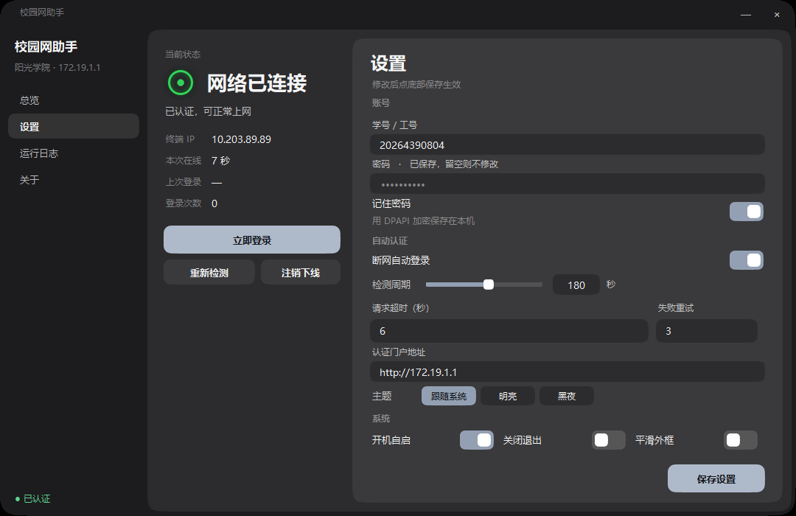
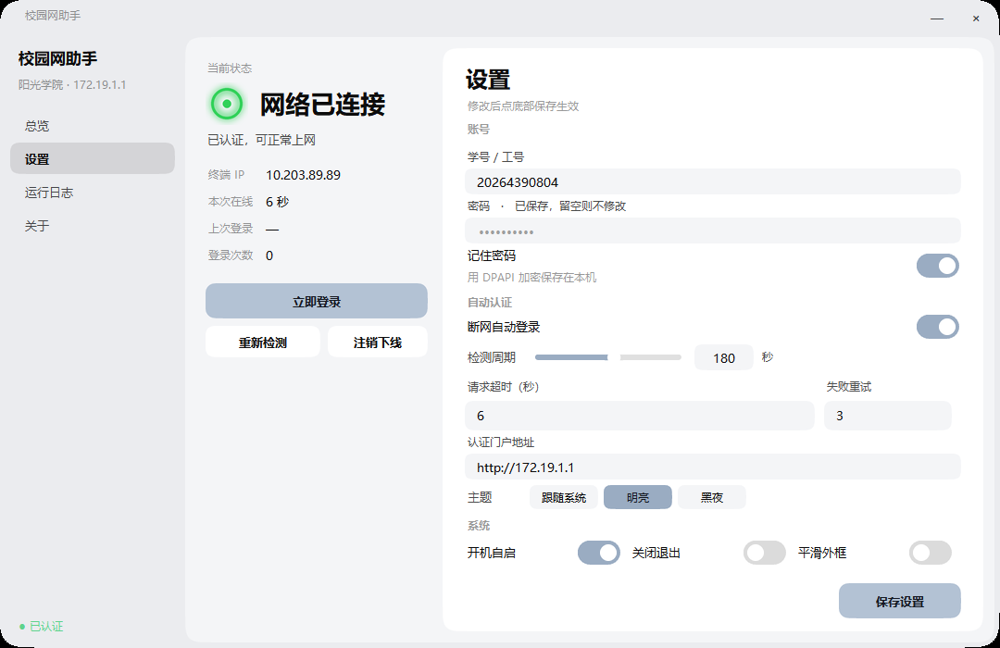
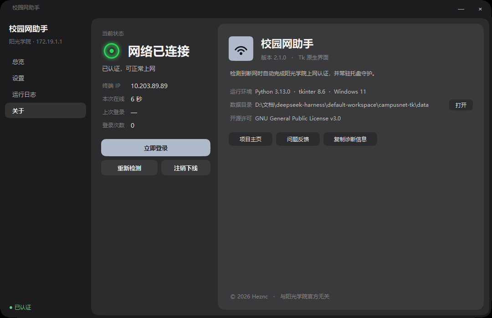
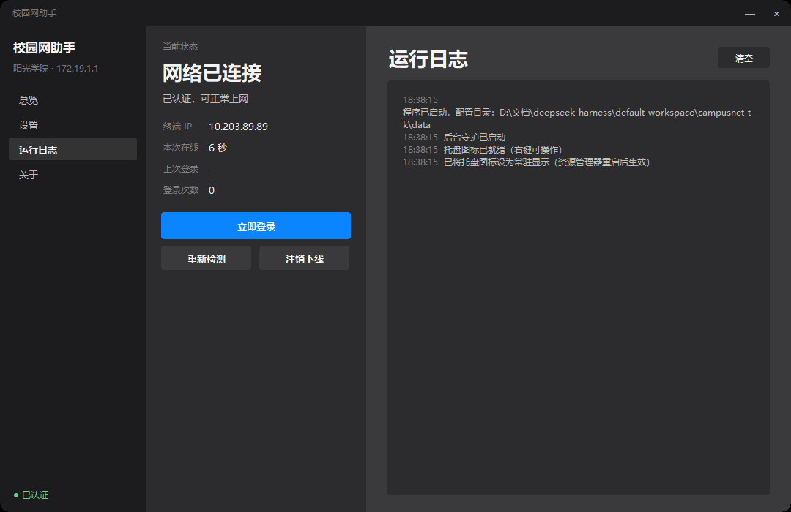

# 校园网助手 · Tk 版

阳光学院（`172.19.1.1`）校园网自动认证工具的 **tkinter 原生界面版**。
断网自动登录、托盘常驻、DPAPI 加密存密码、开机自启——功能和 WebView2 版一致，
但界面换成纯 tkinter 绘制：**没有浏览器内核、没有本地 HTTP 服务**，内存约 65 MB。


 

## 两个版本的区别

| 项目 | [WebView2 版](https://github.com/Heznc/campus-net-assistant) | **Tk 版（本仓库）** |
| --- | --- | --- |
| 界面技术 | HTML/CSS 由 WebView2 渲染 | tkinter 原生控件 + Canvas 自绘 |
| 运行内存 | ~470 MB | **~65 MB** |
| 冷启动 | 2–3 秒（WebView2 初始化） | **< 1 秒** |
| 运行时依赖 | pywebview + pythonnet（.NET/WebView2） | **Python 标准库（tkinter）**；可选 Pillow 提供抗锯齿 |
| 进程结构 | Python 宿主 + 5 个 msedgewebview2 进程 | 单进程 |
| 本地服务 | 起一个 127.0.0.1 的 HTTP 服务给界面调 | **不需要**，界面直接读引擎状态 |
| 视觉风格 | 渐变、毛玻璃、自绘标题栏 | 三级灰 + 层叠卡片 + 超椭圆圆角，无渐变无描边 |
| 主题 | 深色 / 浅色两套 | **跟随系统 / 明亮 / 黑夜**（可切换并记住） |
| 仓库 | `campus-net-assistant` | `campus-net-assistant-tk`（本仓库） |

功能完全对等：断网自动登录、失败退避、托盘菜单、单实例、密码 DPAPI 加密、开机自启、日志。

选哪个：想要**极致轻量、启动快、无额外依赖** → 本仓库；想要**网页级的动效与毛玻璃** → WebView2 版。

## 界面

三栏**层叠**布局，不是并排三块：

```
窗口（无边框 + 自绘标题栏）
└─ 侧栏 #1c1c1e            ← 最底层，铺满左侧
   └─ 中栏卡片 #2c2c2e      ← 浮在侧栏上，四周留 6px，圆角 28px
      └─ 内容卡片 #3a3a3c   ← 嵌进中栏，圆角 26px
```

- **圆角**：卡片/按钮/输入框全部超椭圆（squircle），4× 超采样抗锯齿；
- **状态光环**：标题左侧一个圆环，绿=已认证、琥珀=待认证、蓝=检测中、红=门户不可达；
- **倒计时**：中栏显示「下次检测 2 分 50 秒后」，每秒刷新；
- **悬浮保存**：设置页的「保存设置」固定在右下角，内容滚动不会压到它；
- **未保存提醒**：改过设置直接切页会弹三选一（保存 / 不保存 / 取消）；
- **首次引导**：没有账号密码时进入欢迎页，填完直接保存并登录。

 

## 快速开始

```bat
python tk_app.py          :: 直接运行
python tk_app.py --hidden :: 只驻留托盘（开机自启用）
```

也可以双击 **`启动.vbs`**（无控制台、不闪黑框）或 `启动.bat`。

要求：Windows 10/11 + Python 3.9+。tkinter 是标准库，不装任何东西也能跑；
想要圆角抗锯齿就装一下 Pillow（装了自动启用，没装则退化为普通多边形）：

```bat
pip install pillow
```

**首次启动进入引导页**：填学号 + 密码 →「保存并登录」，之后断网自动认证。

## 窗口行为

- **点 × 收进托盘**，程序继续守护；托盘不可用时自动退回「最小化」，窗口不会消失；
- 退出请用**托盘右键 → 退出**；
- **任务栏有按钮**，最小化/恢复都正常，恢复后不会冒出系统原生标题栏；
- **单实例**：重复双击只会提示「已经在运行」，不会再开一个窗口。

## 目录结构

```
campusnet-tk/
  tk_app.py           界面（tkinter，三栏层叠 + 自绘控件 + 主题）
  engine.py           认证引擎（检测 / 登录 / 注销 / 配置，无界面无 HTTP）
  portal.py           门户接口客户端
  aes128.py           门户口令加密（AES-128-ECB）
  store.py            配置、DPAPI 凭据、开机自启
  tray.py             任务栏托盘图标（ctypes）
  assets/             应用图标与托盘状态图标
  docs/               截图
  启动.vbs            无控制台启动（推荐）
  启动.bat            排错用（带控制台）
  后台守护.bat         仅后台守护（--hidden）
  刷新任务栏.bat       重启资源管理器，刷新任务栏/托盘图标缓存
  tools/
    build_exe.ps1     打包 onedir exe 并附带源码
    version_info.txt  exe 版本信息（任务管理器显示「校园网助手」）
```

## 配置与数据

全部在 `data/` 下（`campusnet-tk\data`）：

| 文件 | 内容 |
| --- | --- |
| `config.json` | 账号、加密后的密码、周期、主题、圆角模式等 |
| `assistant.log` | 运行日志 |
| `crash.log` | 启动异常时的堆栈（有才生成） |

主要配置项：

| 键 | 说明 |
| --- | --- |
| `user` / `_password` | 学号 / DPAPI 加密的密码（同机同账户才能解） |
| `interval` | 检测周期，5–3600 秒 |
| `auto_login` | 断网自动登录 |
| `theme` | `system` / `light` / `dark` |
| `win_round` | `big`（44px 大圆角）或 `dwm`（系统圆角，边缘抗锯齿） |
| `autostart` | 开机自启 |

## 性能

| 指标 | 数值 |
| --- | --- |
| 工作集内存 | ~65 MB |
| 空闲 CPU | ~0.1% 单核 |
| 启动到窗口出现 | < 1 秒 |

界面每秒取一次引擎快照，状态签名不变时只更新秒数文本，不重建控件；日志增量追加。

## 已知限制

- **任务栏最外圈圆角**用 `SetWindowRgn` 裁剪（1 位掩码），放大看有 1px 台阶；设置里打开「平滑外框」可切到 DWM 系统圆角，边缘完全平滑但半径变小。
- **打包 exe 的文件图标**：`tools/build_exe.ps1` 打出的 exe 带版本信息，任务管理器显示「校园网助手」；但在这台机器上**打包进程无法注册托盘图标**（`Shell_NotifyIcon` 返回 err=5），所以开机自启和 `启动.vbs` 都改回 `pythonw` 跑源码，代价是任务管理器里那条启动项显示「Python」。
- 无边框窗口从最小化恢复时，程序会在一秒内重新套用无边框，期间可能看到一帧系统标题栏。

## 常见问题

**和 WebView2 版能同时装吗？** 能，但两个程序会抢同一个终端认证，建议只留一个。

**中文标题为什么不是 Georgia？** 字体按系统可用性挑（微软雅黑 → 苹方 → 思源黑体 → Segoe UI），仓库不打包任何字体文件。

**托盘图标不见了？** Windows 11 会把新图标塞进 `^` 溢出区；点开确认，或运行 `刷新任务栏.bat` 重启资源管理器。程序已在资源管理器重启后自动补注册。

**能打包成 exe 吗？** 可以：`tools\build_exe.ps1`（onedir + 附带源码）。注意上面「已知限制」里的托盘问题。

## 许可证

GNU General Public License v3.0，见 [LICENSE](LICENSE)。
Copyright (C) 2026 Heznc
