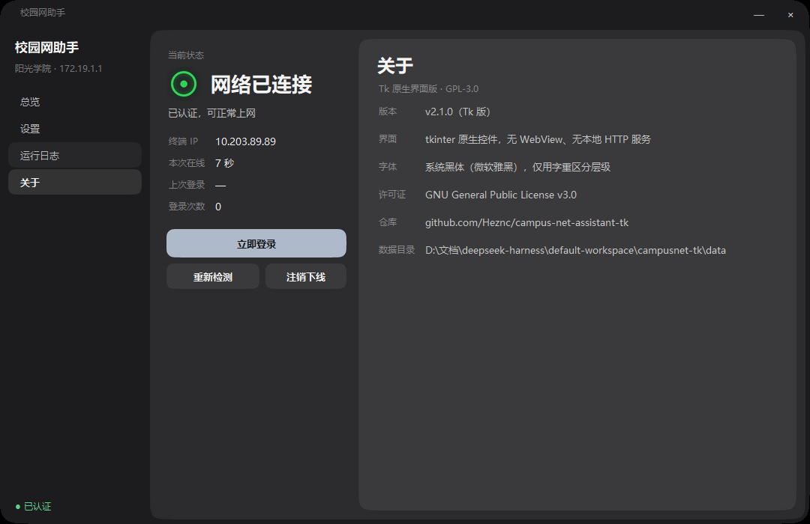

# 校园网助手 · Tk 版

阳光学院（172.19.1.1）校园网自动认证工具的 **tkinter 原生界面版**。
断网自动登录、托盘常驻、DPAPI 加密存密码、开机自启——功能和 WebView2 版一致，
但界面换成纯 tkinter 绘制：**没有浏览器内核、没有本地 HTTP 服务**，内存从 ~470 MB 降到 ~50 MB。



 

## 两个版本的区别

| 项目 | [WebView2 版](https://github.com/Heznc/campus-net-assistant) | **Tk 版（本仓库）** |
| --- | --- | --- |
| 界面技术 | HTML/CSS 由 WebView2 渲染 | tkinter 原生控件 + Canvas 自绘 |
| 运行内存（工作集） | ~470 MB | **~50 MB** |
| 私有内存 | ~320 MB | **~25 MB** |
| 线程 / 句柄 | ~200 / ~3800 | **~18 / ~600** |
| 空闲 CPU | ~0.1% 单核 | ~0.1% 单核 |
| 冷启动 | 2–3 秒（WebView2 初始化） | **0.3–0.5 秒** |
| 运行时依赖 | pywebview + pythonnet（.NET/WebView2） | **Python 标准库（tkinter）**；可选 Pillow 用于圆角抗锯齿 |
| 进程结构 | Python 宿主 + 5 个 msedgewebview2 进程 | 单进程 |
| 本地服务 | 起一个 127.0.0.1 的 HTTP 服务给界面调 | **不需要**，界面直接读引擎状态 |
| 视觉风格 | 渐变、毛玻璃、自绘标题栏 | 三级灰 + 色差分层，**无渐变无描边** |
| 窗口圆角 | 系统 DWM 圆角 | `SetWindowRgn` 12px 圆角 |
| 主题 | 深色 / 浅色两套 | 单套深色（按设计规范） |
| 安装方式 | Inno Setup 安装包 / 便携 zip | 源码运行（`python tk_app.py`） |
| 仓库 | `campus-net-assistant` | `campus-net-assistant-tk`（本仓库） |

两边**功能完全对等**：断网自动登录、失败退避、托盘图标与右键菜单、单实例、
密码 DPAPI 加密、开机自启（启动目录快捷方式）、日志。

选哪个：
- 想要**极致轻量、启动快、无额外依赖** → 本仓库（Tk 版）；
- 想要**更好看的界面、动效、深浅主题** → WebView2 版。

## 界面设计规范

按 macOS Vibrancy 风格约束实现（并按要求**去掉所有描边**，层级完全靠色差）：

| 约束 | 落实方式 |
| --- | --- |
| 灰阶 | 三级灰逐层加深：侧栏（窗口底）`#1c1c1e` → 中栏卡片 `#2c2c2e` → 内容卡片 `#3a3a3c` |
| 无渐变 | 所有元素纯色填充，无 `gradient` |
| 无发光 / 无大阴影 | 不使用任何 shadow；唯一例外是状态光环的外发光（按需求加的） |
| 无装饰动画 | 只有颜色瞬切（200ms 级观感），无位移/缩放 |
| 强调色 | 高级灰 `#aeb9c9`（浅灰底 + 深色文字），不用彩色强调 |
| 无描边 | **按你的要求去掉了 1px 边框**，按钮、选框全靠底色明暗区分 |
| 圆角 | 设置里可切「平滑外框」（DWM 系统圆角，边缘抗锯齿）；默认按大圆角裁剪。窗口用 **DWM 圆角**（系统合成器绘制，**边缘抗锯齿**）；中栏/内容卡片超椭圆 22px/20px 逐层内嵌；卡片与日志区 22px、按钮与输入框 18px、导航 16px、标题栏按钮 14px，全部 4× 超采样抗锯齿 |
| 字体 | **统一系统黑体（Microsoft YaHei UI）**，只有字重差异（Regular / Bold），不引入任何需授权的第三方字体 |
| 文本层次 | 白 95% / 70% / 40% 三档（按底色混合计算） |
| 悬停 | 底色提亮 5%～9%，无位移、无缩放 |
| 选中态 | 底色 `white/10` + 主文字色；导航项是圆角高亮块 |
| 文字居中 | 按钮文字严格水平垂直居中；输入框文字垂直居中 |

## 快速开始

```bat
cd campusnet-tk
python tk_app.py          :: 直接运行
python tk_app.py --hidden :: 只驻留托盘（开机自启用）
```

也可以双击 `启动.bat`。

要求：Windows 10/11 + Python 3.9+。tkinter 是标准库，**不装任何东西也能跑**；
想开圆角抗锯齿就装一下 Pillow（装了自动启用，没装则退化为普通圆角）：

```bat
pip install pillow
```

检测周期既能拖滑杆（5 秒 ~ 1 小时，对数刻度，常用区间更好调），也能直接点右边输入框敲秒数。

**首次启动会直接进入引导页**：填学号 + 密码 → 点「保存并登录」，之后断网会自动认证。

窗口行为：

- **层叠结构**：侧栏是最底层（与窗口同色），中栏卡片浮在其上、四周留 6px，
  内容卡片再嵌进中栏里、四周留 6px 露出中栏色——一层压一层，不是并排三块；
- **顶部标题不占色块**：文字直接落在底色上，没有单独的标题栏色条；
- **可调整大小**：拖动窗口任意边缘/四角即可拉伸（最小 900×560），布局跟随重排；
- **内容可滚动**：设置页等内容超出时用鼠标滚轮滚动，滚动条隐藏；
- **点 × 只收进右下角托盘**，程序继续守护，托盘单击可重新打开；
- 退出请用**托盘右键 → 退出**；
- 设置里勾「关闭时退出」后，× 才会真的结束进程。

## 目录结构

```
campusnet-tk/
  tk_app.py      界面（tkinter，三栏布局 + 自绘按钮/开关/滑杆）
  engine.py      认证引擎（检测 / 登录 / 注销 / 配置，无界面无 HTTP）
  portal.py      门户接口客户端
  aes128.py      门户口令加密（AES-128-ECB）
  store.py       配置、DPAPI 凭据、开机自启
  tray.py        任务栏托盘图标（ctypes）
  assets/        图标
  docs/          截图
  启动.bat
  smoke_test.py  视图冒烟测试
```

## 性能

实测（12 核机器，空闲 15 秒采样）：

| 指标 | 数值 |
| --- | --- |
| 工作集内存 | 49 MB |
| 私有内存 | 25 MB |
| 线程 | 18 |
| 空闲 CPU | 0.02 秒 / 15 秒 ≈ 0.1% 单核 |
| 启动到窗口出现 | < 0.5 秒 |

界面刷新策略：每秒取一次引擎快照，**状态签名不变时只更新秒数文本**，不重建控件；
日志增量追加，不整表重绘。

## 配置与安全

- 配置：`data/config.json`（与 WebView2 版同结构，可直接拷贝过去复用）；
- 密码：Windows DPAPI 加密，同机其他账户无法解开；
- 开机自启：启动目录快捷方式，任务管理器里显示「校园网助手」；
- 托盘：绿色=已认证、琥珀=待认证、红色=门户不可达，右键可检测 / 登录 / 退出；
- 关闭窗口＝收进托盘（设置里可改为直接退出）。

## 常见问题

**和 WebView2 版能同时装吗？** 能，但两个程序都会去认证同一个终端，建议只留一个。

**中文标题为什么不是 Georgia？** Georgia 没有中文字形，衬线效果由宋体承担；纯英文标题仍走 Georgia。

**想要浅色主题？** Tk 版按设计规范只做单套深色。需要浅色请用 WebView2 版。

**能打包成 exe 吗？** 可以：`pyinstaller --onefile --windowed --name 校园网助手 tk_app.py`
（tkinter 无需额外 hook；注意把 `assets/` 和 `ui` 资源一起带上）。

## 许可证

GNU General Public License v3.0，见 [LICENSE](LICENSE)。
Copyright (C) 2026 Heznc
